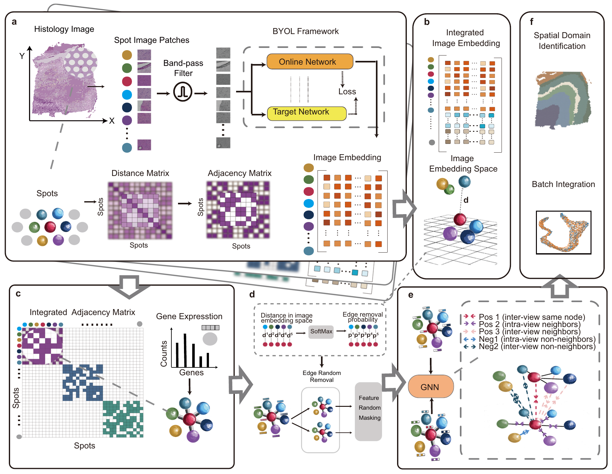

<p align="center">
  
</p>

<h1 align="center">STAIG</h1>

<p align="center"><b>Spatial domains and alignment-free slice integration for spatial transcriptomics,<br>straight from the files your platform writes.</b></p>

<p align="center">
  <a href="https://doi.org/10.1038/s41467-025-56276-0"></a>
  <a href="https://y-itao.github.io/STAIG/"></a>
  <a href="https://github.com/y-itao/STAIG/actions/workflows/ci.yml"></a>
  <a href="https://doi.org/10.5281/zenodo.14238885"></a>
  <a href="LICENSE"></a>
</p>

STAIG (**S**patial **T**ranscriptomics **A**nalysis via **I**mage-aided **G**raph contrastive learning) turns a
spatial transcriptomics section into a map of tissue domains. It learns an embedding of every spot, bin or
cell from its gene expression, its spatial neighbourhood and, when the section has an H&E image, the
histology around it; clustering that embedding gives the domains. The same model embeds several sections
into one space without aligning their coordinates, so slices from different donors, protocols or
platforms can be analysed together. The method is published in
[Yang *et al.*, *Nature Communications* 16, 1067 (2025)](https://doi.org/10.1038/s41467-025-56276-0);
this repository is its second version, rebuilt as a tool that researchers can run without preparing
data by hand.

**Documentation: <https://y-itao.github.io/STAIG/>** — [input formats](https://y-itao.github.io/STAIG/input_formats/),
[quick start](https://y-itao.github.io/STAIG/quickstart/), [tutorials](https://y-itao.github.io/STAIG/tutorials/visium_with_histology/),
[API reference](https://y-itao.github.io/STAIG/api/), [FAQ](https://y-itao.github.io/STAIG/faq/),
[guide for AI agents](https://y-itao.github.io/STAIG/agent_guide/).

```python
import staig

model = staig.run("path/to/spaceranger_outs", n_clusters=7)   # read -> preprocess -> graph -> train -> cluster
adata = model.adata                                             # obs["staig_domain"], obsm["X_staig"]
staig.pl.spatial(adata)
adata.write_h5ad("domains.h5ad")
```

**Works on the output folder of your instrument.** Space Ranger (Visium, Visium HD bins or segmented
cells), Xenium, MERSCOPE, CosMx, SAW (Stereo-seq `.gef`/`.gem`), Slide-seq / Curio Seeker, seqFISH, any
counts + coordinates tables, transcript lists, or an `.h5ad`. Control probes, background and empty cells
are removed, the preprocessing follows the platform, and the histology branch is switched on when the
full-resolution image is next to the data. **One call** in Python, one command in a terminal, or a local
web interface. **Runs anywhere**: Linux, macOS and Windows, CPU or GPU, pure Python (no R, no PyTorch
Geometric). **Built for automation**: a JSON-printing command line, an MCP server and machine-readable
documentation so that AI agents can run it as well.

## Installation

```bash
pip install "staig[image,io] @ git+https://github.com/y-itao/STAIG"
```

Python ≥ 3.10 and PyTorch ≥ 2.1. For a GPU, install the CUDA build of PyTorch first
([pytorch.org](https://pytorch.org/get-started/locally/)); a CPU is enough for every example below
(a Visium section trains in seconds on a GPU and in a few minutes on a laptop CPU).

| extra | adds |
|---|---|
| `image` | torchvision, OpenCV, tifffile: the histology branch (BYOL features from the H&E image) |
| `io` | pyarrow: Visium HD and Xenium parquet tables |
| `cluster` | leiden / louvain clustering as an alternative to the default Gaussian mixture |
| `gui` | the local web interface (`staig gui`) |
| `mcp` | the MCP server for AI agents (`staig-mcp`) |
| `r` | rpy2, to use R `mclust` exactly as in the paper (optional; the Python default needs no R) |

## 60-second start

```bash
staig inspect path/to/outs                                   # which platform, how many cells and genes, QC
staig run path/to/outs --n-clusters 7 --output domains.h5ad  # the whole analysis
staig gui                                                    # the same in a browser, nothing uploaded
```

`path/to/outs` can be any of these; nothing has to be converted first
(details, defaults and the vendor samples each reader was checked on: [Input formats](docs/input_formats.md)):

| platform | what you point STAIG at |
|---|---|
| 10x Visium | the Space Ranger `outs/` folder (`filtered_feature_bc_matrix.h5` + `spatial/`), any Space Ranger version |
| 10x Visium HD | the `outs/` folder (`--bin-size 8/16` µm) or `--hd-level cells` for the segmented cells |
| 10x Xenium | the Xenium Onboard Analysis / Xenium Ranger `outs/` folder |
| Vizgen MERSCOPE | the folder with `cell_by_gene.csv` and `cell_metadata.csv` |
| Bruker CosMx | the AtoMx flat-file export (`*exprMat_file.csv`, `*metadata_file.csv`) |
| BGI Stereo-seq | a SAW `.gef` or `.gem(.gz)` file (`--bin-size` in DNBs, cell bins detected) |
| Slide-seq / Curio Seeker | the puck folder (digital expression + bead locations, or the Seeker MTX output) |
| seqFISH (Spatial Genomics) | the folder with `*CellxGene.csv` and `*CellCoordinates.csv` |
| anything else | a counts table plus a coordinates table (`--coordinates`), a transcript list, or an `.h5ad` with `obsm["spatial"]` |

Several inputs are integrated: `staig run slide_a/ slide_b/ --output integrated.h5ad`.

## Typical analyses

**Visium with H&E (the setting of the paper).** The image found next to the data is used automatically:
patches around every spot are filtered, encoded by a self-supervised network, and the resulting
similarities steer the graph augmentation.

```python
model = staig.run("path/to/visium_outs", n_clusters=7)
model = staig.run("path/to/visium_outs", image="path/to/full_resolution.tif")   # image stored elsewhere
adata = staig.datasets.load_dlpfc("151673", download=True)                        # the paper's DLPFC data
staig.run(adata, n_clusters=7); staig.metrics.evaluate(adata)                     # ARI/NMI against the layer labels
```

**Platforms without histology** (Xenium, MERSCOPE, CosMx, seqFISH, Stereo-seq, Slide-seq, Visium HD).
Targeted panels use every gene; sequencing-based platforms use 3000 highly variable genes.

```python
model = staig.run("path/to/xenium_outs", n_clusters=12)
model = staig.run("path/to/visium_hd_outs", read_kwargs={"bin_size": 16})
model = staig.run("sample.tissue.gef", read_kwargs={"bin_size": 50})
model = staig.run("path/to/cosmx_flat_files", n_seeds=5)
```

**Integrating slices** (same tissue from several donors, serial sections, two platforms). No coordinate
alignment is needed; the model keeps negatives within a slice so that batch effects are not learned.

```python
model = staig.run(["donor_a_outs", "donor_b_outs"], n_clusters=7)      # batch_key="slice" is added
staig.metrics.evaluate(model.adata, batch_key="slice")                   # adds BatchKL and iLISI
```

**Choosing the number of domains and getting stable results.** Leave `n_clusters` out to let the
silhouette score choose it. `n_seeds` trains several models and returns their consensus labelling
(3 seeds by default on a GPU).

```python
model = staig.run("path/to/outs")                        # number of domains chosen automatically
model = staig.run("path/to/outs", n_clusters=7, n_seeds=5, smooth=True)
```

**Your own AnnData or your own image features.** Any AnnData with raw counts and `obsm["spatial"]` works;
features from another image model (UNI, CONCH, a CNN of your own) replace the built-in ones.

```python
staig.img.extract_image_features(adata, method=my_features_array)   # rows in adata.obs order
staig.run(adata, n_clusters=7)
```

**Big sections** (whole Visium HD capture areas, large Stereo-seq chips). Memory is bounded: above
65 536 observations on a GPU (8 000 on a CPU) the contrastive loss samples its negatives automatically;
lower `loss_chunk_size` on small GPUs. See the [large-data tutorial](docs/tutorials/large_datasets.md).

## What you get back

Everything is written into the AnnData (`model.adata` when a path was given):

| key | content |
|---|---|
| `obs["staig_domain"]` | the spatial domains |
| `obsm["X_staig"]` | the learned embedding (and `obsm["X_staig_smooth"]`, the spatially smoothed version used for clustering) |
| `obsm["X_staig_input"]` | the preprocessed model input |
| `obsm["image_features"]`, `obsm["image_pcs"]` | histology features of the spots and their principal components |
| `obsp["spatial_connectivities"]`, `obsp["staig_edge_prob"]` | the spatial graph and the edge-removal probabilities used for augmentation |
| `uns["staig"]` | platform, preprocessing, configuration, QC, timings, loss history, metrics |

`staig.metrics.evaluate(adata)` reports ARI/NMI against a label column when there is one, silhouette and
Davies–Bouldin scores of the embedding, and BatchKL/iLISI for integrated slices.
`staig.pl.spatial` and `staig.pl.umap` draw the result.

## Options worth knowing

| argument | default | when to change it |
|---|---|---|
| `n_clusters` | chosen by silhouette | you know the number of domains |
| `n_seeds` | 3 on a GPU, 1 on a CPU | more seeds for a more stable consensus; `1` for the quickest look |
| `preset` | `"auto"` from the platform | `"paper_151673"` and the other `paper_*` presets reproduce the published settings exactly |
| `image` | `"auto"` | a path to the full-resolution image, or `None` to ignore histology |
| `read_kwargs` | platform defaults | `bin_size`, `level="cells"`, `min_counts`, `coordinates` |
| `smooth`, `refine` | on | switch off to cluster the raw embedding / skip the neighbourhood vote |
| `epochs`, `tau`, `n_neighbors`, `device`, ... | preset values | any field of `staig.STAIGConfig` can be passed to `run` |

`staig presets --show-default` prints every configuration.

## How it works

1. **Histology features** (optional): a patch around each spot is Gaussian-blurred and band-pass filtered
   to suppress staining differences, then encoded by a self-supervised BYOL/ResNet-50 network trained on
   the section itself.
2. **Graph**: a nearest-neighbour graph over the coordinates; the probability of dropping an edge during
   augmentation comes from the distance of the two spots in image-feature space (or from gene similarity
   / a fixed rate without an image).
3. **Contrastive learning**: two augmented views (edge removal and gene masking) pass through a shared
   graph convolutional network; a neighbour contrastive loss pulls every spot towards itself and its
   spatial neighbours in both views and pushes it away from the rest, leaving image-similar spots out of
   the negatives. For several slices the negatives stay within a slice, which is what makes the
   integration alignment-free.
4. **Domains**: Gaussian-mixture clustering of the embedding, a spatial smoothing/refinement step and,
   if asked, a silhouette-based choice of the number of clusters.

The full description is in the paper; implementation notes are in
[`docs/dev/DESIGN.md`](docs/dev/DESIGN.md).

## For AI agents and automated pipelines

STAIG is meant to be driven by software as well as by people:

* **Machine-readable documentation**: [`llms.txt`](llms.txt) (index) and
  [`llms-full.txt`](llms-full.txt) (the complete documentation in one file) at the repository root
  and on the docs site, for LLM context windows.
* **[`AGENTS.md`](AGENTS.md)**: repository map, invariants, test commands and conventions for coding
  agents working on the code base.
* **[Agent guide](docs/agent_guide.md)**: complete runnable recipes, rules for choosing `n_clusters`,
  `preset` and `n_seeds`, expected run times and how to validate a result.
* **MCP server**: `pip install "staig[mcp]"` and register `staig-mcp` with Claude Desktop / Claude Code /
  Cursor or any MCP client; it exposes `staig_run`, `staig_presets` and `staig_extract_image_features`
  with JSON results ([setup](docs/mcp.md)).
* **JSON everywhere**: `staig run` prints the metrics as JSON and writes a self-describing `.h5ad`;
  `staig inspect` reports what a path contains before anything is trained.
* **Metadata**: [`codemeta.json`](codemeta.json) and [`CITATION.cff`](CITATION.cff).

A minimal agent recipe:

```bash
pip install "staig[image,io] @ git+https://github.com/y-itao/STAIG"
staig inspect /data/sample_outs                      # confirm the platform and the cell count
staig run /data/sample_outs --n-clusters 7 --n-seeds 3 --output /data/sample_domains.h5ad
```

## Documentation

The full documentation is at **<https://y-itao.github.io/STAIG/>**:

* [Input formats](https://y-itao.github.io/STAIG/input_formats/): every supported layout, defaults, QC, validated samples
* [Quick start](https://y-itao.github.io/STAIG/quickstart/) and tutorials:
  [Visium with histology](https://y-itao.github.io/STAIG/tutorials/visium_with_histology/),
  [without histology](https://y-itao.github.io/STAIG/tutorials/no_histology/),
  [integration](https://y-itao.github.io/STAIG/tutorials/integration/),
  [large datasets](https://y-itao.github.io/STAIG/tutorials/large_datasets/),
  [custom image features](https://y-itao.github.io/STAIG/tutorials/custom_image_features/),
  [reproducing the paper](https://y-itao.github.io/STAIG/tutorials/reproducing_the_paper/)
* [API reference](https://y-itao.github.io/STAIG/api/) and [FAQ](https://y-itao.github.io/STAIG/faq/)
* Executed notebooks in [`examples/`](examples) (also rendered on the site)

## Data

The curated datasets of the paper (8.8 GB) are on Zenodo
([record 14231773](https://zenodo.org/records/14231773)); `staig.datasets` downloads only what you ask
for:

```python
staig.datasets.download_dataset(root="Dataset", members=["DLPFC/151673", "other/starmap"], include_full_image=False)
adata = staig.datasets.load_dlpfc("151673", root="Dataset")
```

## FAQ

* **Do I need an h5ad?** No; point `staig.run` / `staig run` at the platform's output folder. Use an
  `.h5ad` when you already have one (`obsm["spatial"]` required).
* **Do I need a GPU or R?** Neither. A CPU runs everything (slower); R `mclust` is optional (`[r]`).
* **Windows?** Yes, with the CPU build of PyTorch; the test suite runs on Linux, macOS and Windows.
* **How do I get the same domains every time?** Seeds are fixed and recorded; `n_seeds=3` (the GPU
  default) or `5` trains several models and returns their consensus labelling.
* **Where is the code of the paper?** `git checkout v1-archive`, or the `legacy/` folder (reference only);
  `preset="paper_151673"` and the other `paper_*` presets run the published settings in version 2.

## Citation

```bibtex
@article{yang2025staig,
  title   = {STAIG: Spatial transcriptomics analysis via image-aided graph contrastive learning for domain exploration and alignment-free integration},
  author  = {Yang, Yitao and Cui, Yang and Zeng, Xin and Zhang, Yubo and Loza, Martin and Park, Sung-Joon and Nakai, Kenta},
  journal = {Nature Communications},
  volume  = {16},
  pages   = {1067},
  year    = {2025},
  doi     = {10.1038/s41467-025-56276-0}
}
```

## License and acknowledgements

Apache-2.0. The contrastive framework builds on ideas from GCA, GDCL and NCLA; the first implementation
reused code from GraphST; BYOL follows Grill *et al.* (2020).
